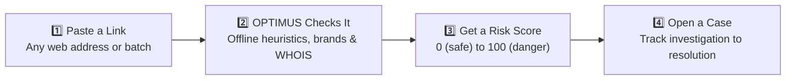
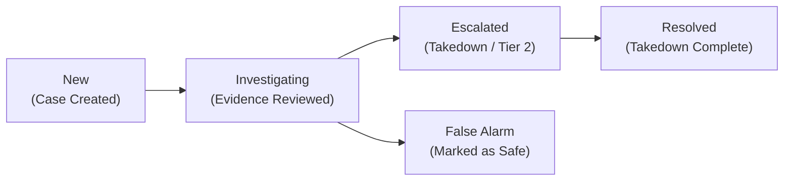

# 🛡️ OPTIMUS — Digital Risk Protection Platform (DRP)

> **Protect every domain, link & brand.**  
> OPTIMUS helps security teams spot fake websites, copycat brand names, and other online threats before they reach customers. Paste a link, see why it is risky, and track it to resolution.

[](https://www.typescriptlang.org/)
[](https://nextjs.org/)
[](https://tailwindcss.com/)
[](https://www.prisma.io/)
[](https://vitest.dev/)

---

## 📖 Quick Overview — User Guide & Quick Start (v1.0)

| Core Pillar | Description |
| :--- | :--- |
| 🛡️ **Check links safely** | **100% SSRF-Safe** offline parsing. Never visits or opens the site you check. |
| 📊 **Explained risk scores** | Transparent scoring from 0 to 100. Every single point has an explicit reason. |
| 📁 **Case tracking** | End-to-end incident response lifecycle from first alert to closed case. |
| 👥 **Clear roles** | Enterprise Role-Based Access Control (`Admin`, `Analyst`, and `Viewer`). |

---

## ⚡ What Can OPTIMUS Do?

1. 🔗 **Check a link**: Paste any web address to see whether it looks safe. OPTIMUS explains each warning it finds with exact point contributions.
2. 🏢 **Catch fake copies of your brand**: Finds lookalike addresses targeting corporate assets, such as `paypa1.com` instead of `paypal.com`.
3. 📧 **Check an email**: Paste raw RFC 5322 email headers to detect sender spoofing, failed SPF/DKIM/DMARC authentication, and suspicious relay hops.
4. 🌐 **Look up domain details**: Query WHOIS registration age and DNS infrastructure via public RDAP & DNS-over-HTTPS. Automatically flags newly registered domains (<30 days).
5. 🗂️ **Check many links at once**: Upload a CSV or TXT file of up to 500 URLs. Get instant batch triage, auto-escalation, and downloadable CSV reports.
6. 📈 **Trend analytics dashboard**: Longitudinal reporting on attack volumes, most targeted brands, and top abused TLDs (`.xyz`, `.top`, `.click`).
7. 🔔 **Real-time alerts**: Push critical alerts immediately to Slack channels (Block Kit), webhook endpoints, or email distribution lists.
8. 🤖 **Plain-English summaries**: Built-in AI Copilot **BILY** explains findings, unpacks technical indicators, and recommends proportional defensive actions.

---

## 🔄 How OPTIMUS Works (In 4 Steps)



---

## 📊 Understanding Results: Risk Scores & Cases

### How to Read the Risk Score

Every analyzed asset receives a score from **0 to 100**. Scores are grouped into four standardized risk tiers:

| Tier | Score Range | Meaning | Recommended Action |
| :--- | :---: | :--- | :--- |
| 🟢 **Low** | `0 – 19` | Nothing suspicious detected | Safe to allow; normal operational domain |
| 🟡 **Medium** | `20 – 39` | Worth a closer look | Monitor asset; potential low-risk anomaly |
| 🟠 **High** | `40 – 69` | Be cautious | Elevated threat vectors; block or sandbox |
| 🔴 **Critical** | `70 – 100` | High-confidence malicious threat | **Act now**: Initiate takedown and block on firewalls |

### What Happens to a Case (SOC Lifecycle)

When a link represents an active threat, analysts open an incident case. Cases move through structured stages:



* **Download a report**: Compile and download comprehensive forensic PDF reports with a single click to share with executive leadership or external registrars.

---

## 👥 Access: Roles & Sample Accounts

Each user is assigned one of three role tiers. Every significant action is automatically logged in an immutable security audit trail.

| Role | Permissions & Capabilities |
| :--- | :--- |
| **Admin** | Manages everything: users, protected brand assets, alert channels, cases, and audit logs |
| **Analyst** | Investigates threats, analyzes links and emails, manages incident cases, exports PDF reports |
| **Viewer** | Read-only access: reviews executive dashboards, findings, and reports without modification rights |

### Pre-Configured Demonstration Accounts

The default seed database comes pre-configured with the following credentials:

| Role | Email | Password | Access Level |
| :--- | :--- | :--- | :--- |
| **Admin** | `admin@optimus-drp.io` | `admin123!` | Full administrator permissions |
| **Analyst** | `analyst@optimus-drp.io` | `analyst123!` | Check links, triage cases, export reports |
| **Viewer** | `viewer@optimus-drp.io` | `viewer123!` | Read-only dashboards and findings |

> [!WARNING]
> **Before going live in production**: Change these default passwords or remove the sample accounts.

---

## 🚀 Setup & Getting Started

### Prerequisites
* **Node.js**: v18.0.0 or newer (v20+ recommended)
* **Database**: PostgreSQL (e.g., Supabase / Neon) or local SQLite for development

### Step 1: Install Dependencies
```bash
npm install
```

### Step 2: Configure Environment
Copy the example settings file:
```bash
cp .env.example .env
```
Fill in your database connection string (`DATABASE_URL`) and session secret (`JWT_SECRET`). Keep `.env` private and never commit it to public version control.

### Step 3: Initialize Database & Seed Sample Data
```bash
npm run db:setup
```
*(Or run `npx prisma db push && node prisma/seed.js`)*

### Step 4: Start the Application
```bash
npm run dev
```
Open **[http://localhost:3000](http://localhost:3000)** in your browser.

---

## 🧪 Try It: Sample Links to Test

Paste these test vectors into the **URL & Threat Analyzer** to see the deterministic heuristic scoring in action:

| Sample Link | Expected Result | Why It Is Flagged |
| :--- | :---: | :--- |
| `login.microsoft.com.account-update-portal.xyz/verify/session` | **Critical** (~85) | Real brand name hidden inside deceptive subdomain on high-risk `.xyz` TLD |
| `paypa1-security-center.top/update-billing` | **Critical** (~75) | Typo-squatting homoglyph substitution (`1` for `l`) targeting registered brand |
| `194.26.29.112:8443/login/verify.php` | **High** (~70) | Direct raw IP address hostname with non-standard web port `8443` |
| `https://www.apple.com/iphone-16-pro/specs/` | **Low** (0) | Verified official domain matching approved brand assets; zero malicious signals |

---

## ❓ Frequently Asked Questions (FAQ)

### Does OPTIMUS visit the links I check?
**No.** OPTIMUS performs 100% offline lexical, structural, and algorithmic inspection. It **never** issues unauthenticated outbound HTTP GET/POST requests to untrusted targets, eliminating Server-Side Request Forgery (SSRF) and malicious payload triggers.

### Can I fully trust a Critical result?
A high risk score indicates strong, correlated evidence of malicious intent (such as homoglyph typosquatting or high Shannon entropy). While statistically reliable, analysts should double-check findings before taking legal takedown actions.

### What if an external threat database is not configured?
OPTIMUS values transparency. If an external API key (such as VirusTotal or Google Safe Browsing) is omitted, the platform explicitly displays `NOT_CONFIGURED` and relies on its built-in heuristic rules. It **never** fabricates results or fills gaps with guesses.

---

## 🏗️ Technology Architecture

* **Frontend**: Next.js 14 App Router, Tailwind CSS, Lucide Icons, Recharts
* **Backend**: Next.js Server Actions & Route Handlers, TypeScript
* **Database & ORM**: PostgreSQL / SQLite with Prisma ORM (10 relational models)
* **Auth & Security**: Stateless JWTs (`jose`), Bcrypt hashing, SSRF sandbox guards
* **Reporting**: `jsPDF` client & server forensic report generator
* **Testing**: Vitest unit & integration test runner (29 automated tests)

---

## 📂 Project Directory Structure

```
optimus/
├── prisma/
│   ├── schema.prisma              # Relational models (Analysis, Brand, Incident, etc.)
│   └── seed.js                    # Enterprise demonstration seed data
├── public/
│   ├── bily-avatar.png            # Optimus Prime avatar for BILY AI Copilot
│   └── logo.png                   # Official platform eagle shield emblem
├── src/
│   ├── app/
│   │   ├── (dashboard)/           # Authenticated SOC workspace
│   │   │   ├── dashboard/         # Real-time metrics & threat feeds
│   │   │   ├── analyzer/          # Single URL & domain inspector
│   │   │   ├── email-analyzer/    # Phishing email header forensics
│   │   │   ├── batch-scanner/     # Bulk URL & CSV triage scanner
│   │   │   ├── analytics/         # Threat trend analytics dashboard
│   │   │   ├── alerts/            # Real-time Slack/Webhook alert rules
│   │   │   ├── findings/          # Searchable detection repository
│   │   │   ├── incidents/         # SOC incident management cases
│   │   │   ├── brands/            # Protected brand assets registry
│   │   │   └── audit-logs/        # Immutable compliance audit log
│   │   └── api/                   # RESTful API endpoints & handlers
│   ├── components/
│   │   ├── ai/                    # BILY Copilot floating assistant widget
│   │   ├── analyzer/              # WhoisPanel, BatchUpload, EmailResultCard
│   │   ├── dashboard/             # TrendCharts & KPI widgets
│   │   └── navigation/            # Liquid glass sidebar & topbar
│   └── lib/
│       ├── alerts/                # Webhook & Slack notification dispatcher
│       ├── detection/             # Parser, signals, WHOIS/RDAP, risk scorer
│       ├── threat-intel/          # Multi-source threat feed adapters
│       └── pdf/                   # Forensic PDF report compiler
└── tests/                         # Vitest automated test suite (9 test suites)
```

---

## 📄 License
Educational and defensive cybersecurity operations platform. Built for digital risk protection and SOC operations.
